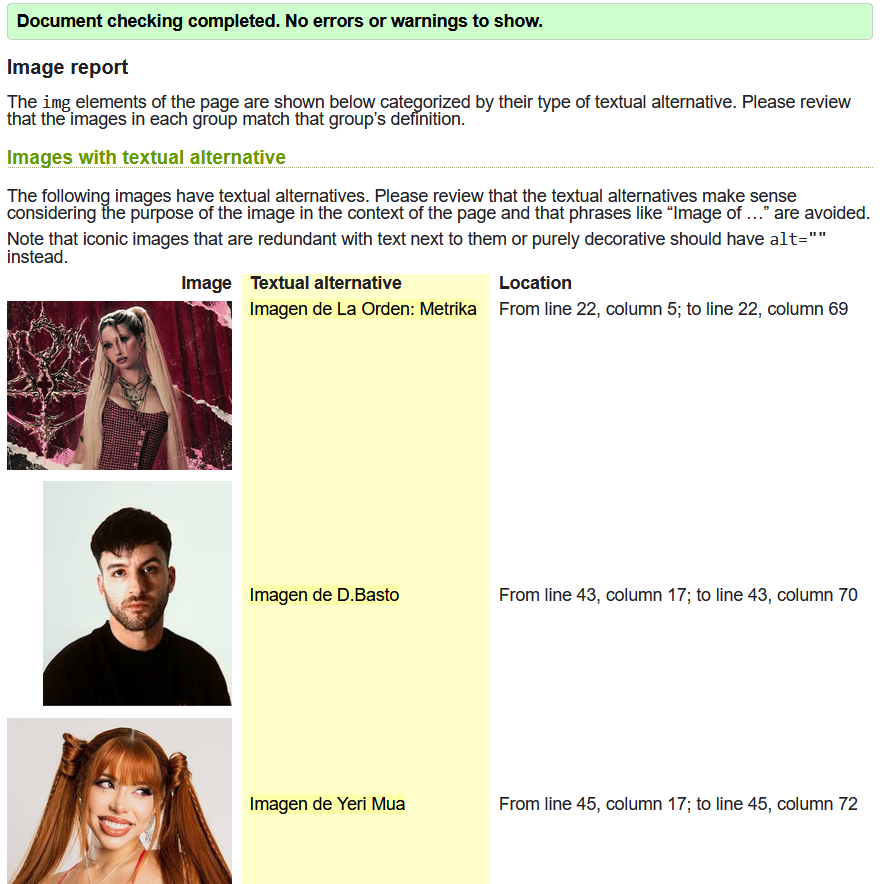
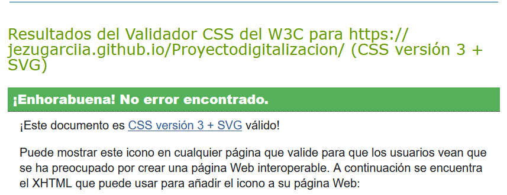
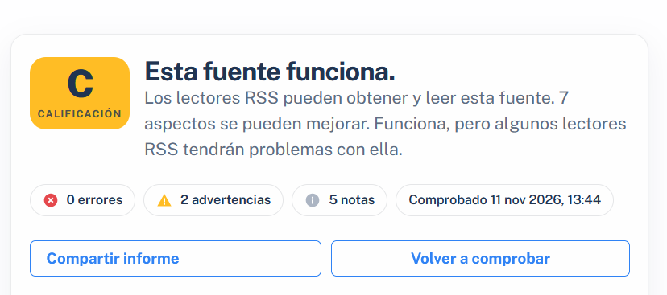

"# Proyectodigitalizacion" 
# Título del proyecto
Trabajo acerca del nuevo álbum de la cantante española Metrika, así como el análisis de las canciones.
## Autoría
- Nombre y apellidos: Jesús García Gallego.
- Curso: 1º
- Módulo: DAM A
- Fecha: 11/11/26
## Sitio publicado
- Web en GitHub Pages: [Abrir sitio](https://jezugarciia.github.io/Proyectodigitalizacion/)
- Repositorio: [Abrir repositorio](https://github.com/jezugarciia/Proyectodigitalizacion)
## Estructura del proyecto
- `index.html`: Presentación sobre Metrika, al álbum y sus colaboradores.
- `partesalbum.html`: Presentación de las distintas partes del álbum así como la explicación de las canciones.
- `video.html`: Metricorto sobre La Orden y fotografias de Metrika y su proyecto.
- `inscripcion.html`:Formulario donde inscribirse al club de fans de Metrika.
- `recorrido.html`: Breve tabla que muesta los álbums y EP de la artista.
- `rss.xml`: descripción del canal RSS.
- `css/estilos.css`: estilos básicos compartidos.
## Tecnologías utilizadas
- HTML5
- CSS
- XML y RSS
- Git
- GitHub
- GitHub Pages
## Características principales
- Navegación entre cinco páginas.
- Uso de HTML semántico.
- Tabla accesible.
- Galería con varios formatos.
- Contenido multimedia.
- Formulario con validación HTML.
- Canal RSS.
## Validación
### HTML

### CSS

### RSS

## Dificultades encontradas
Describe al menos tres dificultades reales:
1. El documento xml daba error por una mala gestión de datos, tras ello, se volvió a realizar siguiendo las pautas necesarias.
2. Segunda dificultad y cómo se resolvió.
3. Tercera dificultad y cómo se resolvió.
## Decisiones técnicas
Explica brevemente:
- Cómo has organizado los archivos.
He organizado los archivos en distintas carpetas: images,video,audio etc.
- Qué partes de la plantilla se repiten.
No se repiten muchas partes, ya que al cada página estar dedicada a algo distinto requiere estructuras distintas. Lo único fijo es el nav.
- Qué cambia en cada página.
El contenido y la presentación de esta misma, puede cambiar tanto el modo en el que está añadida la información hasta la cantidad de imagenes que presenta.
- Por qué has elegido determinados formatos de imagen.
Ya que son los más optimos a la hora de utilizarlos en una página web.
- Cómo has utilizado rutas relativas.
Las he utilizado para que el usuario pueda acceder directamente a la información extra que está leyendo, sin tener que buscarla.
- Cómo has preparado el proyecto para la siguiente práctica de CSS.
He utilizado un fondo en negro y con ayuda de la IA he podido reforzar mi conocimiento de css.
## Fuentes y licencias
Este proyecto utiliza recursos propios y de terceros, respetando las licencias correspondientes. Todas las imagenes se encuentran en dominio público.
Tanto el vídeo como la música pertenecen a Metrika,CC BY-NC 4.0, permitiendo usarlo sin fines comerciales.